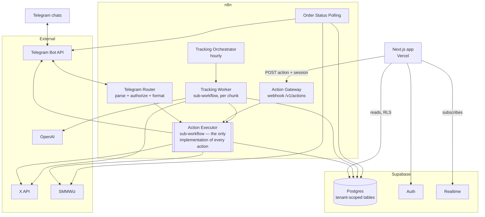

# XMonitor — Multi-Tenant Accounts and Web Moderation UI

Design record for two changes that arrive together:

1. **Multi-tenancy** — tracked X accounts belong to specific clients, and the one Telegram
   bot serves several chats without leaking data between them.
2. **Web UI** — an internal (later client-facing) interface that shows the same information
   as the alerts and performs the same moderation actions.

Status: **partly implemented.** Written 2026-08-24 as design only, against live production
Supabase `jxnzdxyhoakpfmkbjdeq` and the exports in `workflows/active/`. Phases **T1**
(tenancy schema) and **T2** (authorization) shipped to both environments on 2026-08-29 —
see §12a, §12b and §12c. Sections 3–10 still describe the option space, not what is built.

> **[§11 Decisions taken](#11-decisions-taken--2026-08-24) is authoritative.** Sections 3–10
> were written before the design review and describe the option space; where a decision
> differs from the assumption in an earlier section, the decision wins. Rate limits, X API
> cost, and the moderation queue live in the companion register,
> **[limits-and-capacity.md](./limits-and-capacity.md)**.

---

## 1. Current state (verified, not assumed)

The system is **flat**: there is no tenancy concept anywhere in the schema or the workflows.

| Table | Ownership column | Reality |
| --- | --- | --- |
| `Tracked Users` | none | 3 rows, global list. `Build X API Query` reads **all** of them into one X query. |
| `Telegram Users` | none — `(id, created_at, chat_id)` only | 1 row. The scheduler alerts **every** row about **every** flagged post. |
| `Posts` | `user_id` → `Tracked Users` (ON DELETE CASCADE) | Ownership is derivable via the tracked account. `status` is global. |
| `Replies` | `post_id` → `Posts` (ON DELETE CASCADE) | Same. |
| `X Auth Accounts` | `telegram_chat_id` | The **only** existing per-chat signal. 10 rows, 8 of them under chat `8372903693`. |
| `Order Info` | `telegram_chat_id` | Per-actor already; no FK to `Posts`. |

Two documentation claims do not match the live workflow and should be corrected:

- `docs/workflows/xmonitor-telegram-router.md` says `Telegram Users` is a *"link between
  Telegram chat and tracked X user"*. It is not. The node `Link Telegram User To X User`
  writes a single field, `chat_id`. There is no linkage column and never has been.
- The same doc says `Clear Tracked Users For Chat` clears *"the chat's existing"* tracked
  users. It does not — see below.

### 1.1 Blocking defect: `/track` destroyed all data for all clients

> **Fixed 2026-08-24.** Kept here because it is the reason several decisions below exist.
> Migration `db/migrations/2026-08-24-tracked-users-soft-delete.sql`, evidence in
> `tests/n8n/telegram-router-risky-pins/TRACK-FIX-EVIDENCE.md`, behavior in
> `docs/workflows/xmonitor-telegram-router.md`.

`Clear Tracked Users For Chat` was a Supabase `delete` on `Tracked Users` with a single
condition carrying no value:

```json
{ "keyName": "user_id", "condition": "neq" }
```

It matched every row. Combined with `Posts_user_id_fkey` and `Replies_post_id_fkey` both
being `ON DELETE CASCADE`, one `/track` from any chat deleted **every tracked account →
every post → every reply, for everybody** — which is why 22 posts and 913 replies was the
entire production dataset.

**Correction:** an earlier draft of this section said the sibling node
`Clear Telegram User Links` was correctly scoped to the caller's `chat_id`. It was not — it
carried the identical defect (`chat_id neq` with no value) and was invisible only because
`Telegram Users` held a single row. Both nodes were fixed together.

What shipped, and what it means for the rest of this document:

| Change | Consequence here |
| --- | --- |
| `Tracked Users.telegram_chat_id` added | The first ownership column the table has ever had. §3 replaces it with `client_id`; treat it as a proto-tenancy key, not a permanent one. |
| `Tracked Users.is_active` added; delete replaced by a chat-scoped `is_active = false` | Untracking no longer destroys history. §4.2 already specifies `is_active`, so that column is done. |
| `Posts_user_id_fkey` → `ON DELETE RESTRICT ON UPDATE CASCADE` | Matches §4.2's requirement exactly. A future unscoped delete now fails loudly instead of cascading. `Replies_post_id_fkey` stays `CASCADE` deliberately — deleting a post *should* take its replies. |
| `Upsert Tracked X User` became a Postgres node with `ON CONFLICT (user_id) DO UPDATE` guarded by `telegram_chat_id IS NULL OR telegram_chat_id = EXCLUDED.telegram_chat_id` | **Decision #2 is already enforced in the database** — one chat cannot take over a handle another chat tracks. §3's exclusivity requirement is delivered at the chat level and only needs re-pointing at `client_id`. |

Two non-destructive gaps were left open by that fix and still need closing:

1. A blocked ownership takeover reports success to the caller.
2. A failed X lookup leaves the caller's accounts deactivated, because only the parse — not
   the lookup — precedes the deactivate. **Monitoring stops silently for that chat until
   someone re-runs `/track`.** This is an availability defect, not a data one, but it fails
   quiet, which is worse than it sounds.

### 1.2 Other constraints that multi-tenancy will break immediately

| # | Constraint | Where | Consequence at 5–10 clients |
| --- | --- | --- | --- |
| A | One X query for all handles, `max_results=50`, no pagination | `Build X API Query`, `Get posts of tracked users` | 50 posts are shared across *all* clients. At 30 accounts each client sees ~1.6 posts/run. Silent starvation, no error. |
| B | Full-archive query length cap: **1024 chars** self-serve, 4096 enterprise | X API | `from:handle OR ` ≈ 21 chars → the post query dies at ~48 handles. |
| C | Replies query is `(conversation_id:… is:reply)` joined with ` OR ` ≈ 50 chars each | `Build Replies Query` | Caps at **~20 conversations**. Post #21 makes X return 400 and the whole hourly run fails. Already latent today. |
| D | One OpenAI call receives every post and every reply as one JSON blob | `Analyze Sentiment with ChatGPT` | Context and cost grow with total client volume; one oversized run fails for everyone. |
| E | No alert dedupe — grep for `last_alerted`/`alerted_at` returns 0 | scheduler | A flagged post re-alerts **every hour, forever**, until someone ignores or snoozes it. |
| F | Every reply is re-analyzed every run (only *negative* replies are stored, and no sentiment column exists) | `Filter Negative Replies` | OpenAI cost is O(all replies in window) per run per client, not O(new replies). |
| G | X hide rate-limit state cached in **n8n workflow static data** | router hide branch | Rate limits are per *access token*; one global cache is wrong the moment two clients hide concurrently, and it is invisible to a second entry point (the UI). |
| H | `Posts.status` holds suppression *and* order lifecycle in one column | router + order poller | `New`/`Snoozed`/`Ignored` vs `Processing`/`Done`/`Order Failed`. An order in flight silently erases a snooze. |
| I | ~~No authorization on callbacks — any chat that knows a `post_id` can hide replies~~ **Closed by T2, 2026-08-29 (§12c)** | `Parse Telegram Message` | Was: cross-tenant moderation, and post ids appear in X URLs so they are not secret. Now gated on the post's owner, with `Staff` able to act across clients. |
| J | `snooze_runs_remaining` counts *scheduler runs*, not time | router + scheduler | Breaks as soon as cadence becomes per-client, and is awkward to display in a UI. |

---

## 2. Target architecture



Three ideas carry the whole design:

1. **One tenancy anchor.** A tracked X account belongs to exactly one client. Everything
   else — posts, replies, orders, alerts, actions — inherits ownership from it.
2. **One action implementation.** Hide / ignore / snooze / resume / order are extracted out
   of the Telegram router into an **Action Executor** sub-workflow. Telegram and the UI are
   both *front ends* that call it. Two implementations would drift within a month; the
   X token refresh, rate-limit handling, provider error classification, and dedupe logic
   are all non-trivial and must exist once.
3. **Reads bypass n8n.** The UI reads Postgres directly under RLS and subscribes to
   Realtime. n8n is only in the write path. This keeps the UI fast and cheap, and keeps
   n8n execution volume flat as the UI gets used.

---

## 3. Tenancy model

**A tracked X account belongs to exactly one client.** `Tracked Users.user_id` is already the
primary key, so global exclusivity is free — two clients cannot track the same handle. This
is a deliberate constraint, not an oversight: two parties moderating the same account's
replies would race on every hide. If it ever needs to change, the PK becomes
`(client_id, user_id)` and `Posts.user_id` becomes a composite FK — a large migration, so
decide now rather than later (see §11 Q1).

Two identity planes, one tenancy plane:

| Plane | Table | Identity | Used by |
| --- | --- | --- | --- |
| Telegram | `Client Members` | `chat_id` | bot alerts and buttons |
| Web | `Client Access` + `App Users` | `auth.users.id` | UI session |
| Tenancy | `Clients` | `client_id` | everything |

A chat may belong to several clients (the operator team's chat can receive everything);
authorization is always *"is this actor a member of the client that owns this post, or
staff?"*, never *"which client is this chat?"*.

Optional but recommended: `Client Members.app_user_id` links a Telegram chat to a web user,
so the audit trail can say "Tarek, via Telegram" and "Tarek, via web" as the same person.

---

## 4. Data model changes

Written as a migration set under `supabase/migrations/`. Table names keep the existing
quoted-Title-Case convention so nothing else has to be renamed.

### 4.1 New tables

```sql
create table public."Clients" (
  id                  uuid primary key default gen_random_uuid(),
  slug                text not null unique,
  name                text not null,
  is_active           boolean not null default true,
  -- runtime tunables, read at the start of every run (FB Monitor Config pattern)
  lookback_days       integer not null default 7   check (lookback_days > 0),
  min_replies         integer not null default 10  check (min_replies >= 0),
  negative_threshold  numeric not null default 0.50
                        check (negative_threshold >= 0 and negative_threshold <= 1),
  max_posts_per_run   integer not null default 25  check (max_posts_per_run > 0),
  quiet_hours_start   time,          -- null = no quiet hours
  quiet_hours_end     time,
  timezone            text not null default 'Asia/Beirut',
  created_at          timestamptz not null default now(),
  updated_at          timestamptz not null default now()
);

-- Telegram identity plane
create table public."Client Members" (
  id              bigint generated always as identity primary key,
  client_id       uuid not null references public."Clients"(id) on delete cascade,
  chat_id         text not null,
  chat_type       text not null default 'private'
                    check (chat_type in ('private','group','supergroup','channel')),
  label           text,
  role            text not null default 'client'
                    check (role in ('operator','client')),   -- decision #1: two roles, not four
  receives_alerts boolean not null default true,
  is_active       boolean not null default true,
  app_user_id     uuid references auth.users(id) on delete set null,
  created_at      timestamptz not null default now(),
  updated_at      timestamptz not null default now(),
  unique (client_id, chat_id)
);
create index client_members_chat_idx on public."Client Members"(chat_id) where is_active;

-- Web identity plane
create table public."App Users" (
  id         uuid primary key references auth.users(id) on delete cascade,
  email      text,
  full_name  text,
  is_staff   boolean not null default false,   -- sees and acts on every client
  created_at timestamptz not null default now()
);

create table public."Client Access" (
  client_id uuid not null references public."Clients"(id) on delete cascade,
  user_id   uuid not null references public."App Users"(id) on delete cascade,
  role      text not null default 'viewer' check (role in ('owner','editor','viewer')),
  created_at timestamptz not null default now(),
  primary key (client_id, user_id)
);

-- Audit trail + async action state. Serves the UI's "did my click work?" and the
-- idempotency guard shared by both front ends.
create table public."Action Log" (
  id              uuid primary key default gen_random_uuid(),
  idempotency_key text not null unique,
  client_id       uuid not null references public."Clients"(id) on delete cascade,
  action          text not null,           -- see §6 action catalogue
  post_id         text,
  params          jsonb not null default '{}'::jsonb,
  channel         text not null check (channel in ('telegram','web','system')),
  actor_chat_id   text,
  actor_user_id   uuid references auth.users(id) on delete set null,
  status          text not null default 'queued'
                    check (status in ('queued','running','succeeded','partial','failed','denied')),
  result          jsonb not null default '{}'::jsonb,
  error_category  text,
  error_message   text,
  n8n_execution_id text,
  created_at      timestamptz not null default now(),
  started_at      timestamptz,
  finished_at     timestamptz
);
create index action_log_client_created_idx on public."Action Log"(client_id, created_at desc);
create index action_log_post_idx on public."Action Log"(post_id, created_at desc);

-- Per-token X rate-limit state, replacing n8n workflow static data (defect G)
create table public."X Rate Limits" (
  x_user_id  text not null,
  endpoint   text not null,          -- e.g. 'tweets.hidden.put'
  limit_max  integer,
  remaining  integer,
  reset_at   timestamptz,
  updated_at timestamptz not null default now(),
  primary key (x_user_id, endpoint)
);
```

### 4.2 Altered tables

```sql
alter table public."Tracked Users"
  add column client_id    uuid references public."Clients"(id) on delete restrict,
  add column is_active    boolean not null default true,
  add column display_name text,
  add column added_at     timestamptz not null default now();
create index tracked_users_client_idx on public."Tracked Users"(client_id) where is_active;
-- after backfill: alter column client_id set not null;

-- ON DELETE RESTRICT is deliberate: untracking must never cascade posts away again.
-- Untracking = is_active = false, not DELETE.

alter table public."Posts"
  add column client_id uuid references public."Clients"(id) on delete cascade,
  -- split the overloaded status column (defect H)
  add column suppression_status text not null default 'active'
        check (suppression_status in ('active','snoozed','ignored')),
  add column snoozed_until timestamptz,                  -- replaces run counting (defect J)
  add column order_state text
        check (order_state in ('processing','done','failed')),
  -- alert dedupe (defect E)
  add column last_alerted_at timestamptz,
  add column alerted_negative_count integer not null default 0,
  add column negative_ratio numeric,
  add column analyzed_count integer not null default 0,
  add column post_url text;
create index posts_client_state_idx
  on public."Posts"(client_id, suppression_status, last_alerted_at desc);

alter table public."Replies"
  add column client_id uuid references public."Clients"(id) on delete cascade,
  add column sentiment text check (sentiment in ('Positive','Neutral','Negative')),
  add column analyzed_at timestamptz,                    -- skip re-analysis (defect F)
  add column claimed_by uuid references public."Action Log"(id) on delete set null,
  add column moderated_at timestamptz,
  add column last_moderation_error text,
  add column author_username text;
create index replies_post_status_idx on public."Replies"(post_id, status);
create index replies_client_idx on public."Replies"(client_id);

alter table public."Order Info"
  add column client_id uuid references public."Clients"(id) on delete cascade,
  add column actor_user_id uuid references auth.users(id) on delete set null,
  add column channel text check (channel in ('telegram','web'));
create index order_info_client_idx on public."Order Info"(client_id, created_at desc);

alter table public."X Auth Accounts"
  add column client_id uuid references public."Clients"(id) on delete cascade,
  add column connected_by_chat_id text,     -- rename intent of telegram_chat_id
  add column revoked_at timestamptz,
  add column last_refresh_error text;
```

`client_id` on `Posts`, `Replies`, and `Order Info` is denormalized — it is derivable through
`Tracked Users`, but a direct column keeps every RLS policy a single indexed equality check
instead of a join, which matters because RLS runs per row.

### 4.3 Denormalization integrity

Keep the copies honest with a trigger rather than trusting every writer:

```sql
create or replace function public.set_post_client_id()
returns trigger language plpgsql security definer set search_path = '' as $$
begin
  select tu.client_id into new.client_id
  from public."Tracked Users" tu where tu.user_id = new.user_id;
  return new;
end $$;

create trigger posts_set_client before insert or update of user_id
  on public."Posts" for each row execute function public.set_post_client_id();
```

Same shape for `Replies` (from `Posts`) and `Order Info` (from `Posts`).

### 4.4 Backfill

All existing data belongs to one client. Volumes are tiny (3 tracked accounts, 22 posts,
913 replies), so this is a single transaction:

```sql
insert into public."Clients"(slug, name) values ('house','House Account')
  returning id;                    -- :house

update public."Tracked Users" set client_id = :house;
update public."Posts"   set client_id = :house;
update public."Replies" set client_id = :house;
update public."Order Info" set client_id = :house;
update public."X Auth Accounts" set client_id = :house,
       connected_by_chat_id = telegram_chat_id;

insert into public."Client Members"(client_id, chat_id, role, label)
select :house, chat_id, 'operator', 'migrated' from public."Telegram Users";

-- status split
update public."Posts" set
  suppression_status = case status when 'Snoozed' then 'snoozed'
                                  when 'Ignored' then 'ignored' else 'active' end,
  order_state        = case status when 'Processing' then 'processing'
                                   when 'Done' then 'done'
                                   when 'Order Failed' then 'failed' end,
  snoozed_until      = case when status = 'Snoozed' and snooze_runs_remaining > 0
                            then now() + make_interval(hours => snooze_runs_remaining) end;
```

`Telegram Users` and `Posts.status`/`snooze_runs_remaining` stay in place, written by both
old and new code, until every workflow is cut over — then dropped in a later migration.

---

## 5. Row Level Security

RLS is enabled on every table today with **zero policies**, so only `service_role` and the
Postgres role can read. n8n keeps using those and stays unaffected by everything below.
Policies exist purely so the browser can read directly.

```sql
create or replace function public.acting_client_ids()
returns setof uuid language sql stable security definer set search_path = '' as $$
  select ca.client_id
  from public."Client Access" ca
  where ca.user_id = (select auth.uid())
  union
  select c.id from public."Clients" c
  where exists (select 1 from public."App Users" u
                where u.id = (select auth.uid()) and u.is_staff);
$$;
revoke all on function public.acting_client_ids() from public, anon;
grant execute on function public.acting_client_ids() to authenticated;
```

Then one policy shape per tenant table:

```sql
create policy "read own client" on public."Posts"
  for select to authenticated
  using (client_id in (select public.acting_client_ids()));
```

Notes that matter:

- `security definer` avoids policy recursion when `Client Access` itself is RLS-protected.
- `(select auth.uid())` is wrapped so Postgres evaluates it once per statement, not per row.
- **Read-only, always.** No `insert`/`update`/`delete` policies for `authenticated` on any
  table. Every write goes through the Action Gateway, which re-authorizes server-side. A
  browser that can `UPDATE Posts` directly can snooze a post without an audit row, and can
  desync `Posts.status` from what the Telegram alert message shows.
- `Replies.text` and `X Auth Accounts` tokens: never expose the auth table to
  `authenticated` at all. The UI needs *connection status*, not tokens — serve it from a
  view:

```sql
create view public."Tracked Account Status"
with (security_invoker = true) as
select tu.client_id, tu.user_id, tu.username, tu.display_name, tu.is_active,
       (a.x_user_id is not null and a.revoked_at is null) as is_connected,
       a.expires_at as token_expires_at,
       a.scope, a.last_refresh_error
from public."Tracked Users" tu
left join public."X Auth Accounts" a on a.x_user_id = tu.user_id;
```

`security_invoker = true` makes the view run under the caller's RLS rather than the
owner's — without it the view is a tenancy hole.

---

## 6. The action layer

This is the load-bearing piece. Today the router *is* the action implementation: 113 nodes
where parsing, authorization, business logic, external calls, and Telegram formatting are
interleaved. A second front end cannot reuse any of it.

### 6.1 `XMonitor - Action Executor` (new sub-workflow)

Typed input (n8n *Execute Workflow* with "Define Below" inputs), one item per invocation:

```jsonc
{
  "action_id":   "uuid",        // Action Log row, already inserted by the caller
  "action":      "replies.hide",
  "client_id":   "uuid",
  "post_id":     "1234567890",
  "actor": { "channel": "web", "chat_id": null, "user_id": "uuid" },
  "params":      { "reply_ids": ["…"] }
}
```

Output, one item, always the same shape — never a thrown error:

```jsonc
{
  "action_id": "uuid",
  "status": "succeeded | partial | failed | denied",
  "summary": { "attempted": 12, "hidden_now": 9, "already_hidden": 2,
               "failed": 1, "rate_limited": 0, "retry_after": null },
  "user_message": "Hid 9 of 12 replies…",   // channel-neutral prose
  "details": [ { "reply_id": "…", "outcome": "hidden" }, … ],
  "error_category": null
}
```

`user_message` is deliberately channel-neutral. The Telegram router wraps it in Markdown and
buttons; the UI renders it as a toast. Neither owns the wording.

### 6.2 Action catalogue

| Action | Params | Notes |
| --- | --- | --- |
| `post.ignore` | — | `suppression_status='ignored'` |
| `post.snooze` | `duration: 1h\|4h\|12h\|24h` | sets `snoozed_until = now() + duration` |
| `post.resume` | — | `suppression_status='active'`, `snoozed_until=null` |
| `replies.hide` | `reply_ids?: string[]` | omitted = all eligible. **Selective hiding is new and UI-only-practical.** |
| `order.likes.place` | `quantity: int` | real money, no provider cancel. Idempotency-guarded, **not** role-gated — decision #6 |
| `order.comments.preview` | `count: 10..250` | OpenAI generation, no SMM call; returns comments + a `preview_token` |
| `order.comments.place` | `preview_token` | places the SMM order for a previously generated set |
| `account.track` | `username` | resolves via X `users/by/username`, inserts under `client_id` |
| `account.untrack` | `user_id` | `is_active=false`. **Never a DELETE.** |
| `account.connect_link` | `user_id?` | returns an X OAuth URL carrying `client_id` in state |

Splitting `order_comments` into `preview` + `place` is what makes the flow expressible in
both channels. Telegram's current `sendAndWait` prompt becomes a thin wrapper around the two
calls; the UI shows the generated comments in a modal with a Confirm button.

### 6.3 Authorization — inside the executor, not the caller

Every invocation, regardless of channel, first resolves:

```
post_id → Posts.client_id
actor is authorized if:
    channel = 'telegram' and exists Client Members(client_id, chat_id, is_active)
 or channel = 'web'      and (exists Client Access(client_id, user_id) or App Users.is_staff)
```

Failing this returns `status: 'denied'` and writes the attempt to `Action Log`. This closes
defect I and means a leaked gateway secret still cannot act across tenants.

### 6.4 Concurrency — claim before acting

Telegram and the UI can now fire at the same post simultaneously. Hides claim rows first:

```sql
update public."Replies"
   set status = 'hiding', claimed_by = :action_id
 where post_id = :post_id
   and (:reply_ids is null or reply_id = any(:reply_ids))
   and (status is null or status in ('New','hide_failed'))
   and (claimed_by is null)
returning reply_id;
```

Only returned rows get an X call. A stale `hiding` row older than 10 minutes is reclaimable
(a `next_check`-style sweep in the orchestrator). Orders use `Action Log.idempotency_key`
plus a "no open order of this type for this post" guard — double-charging a client is the
worst failure mode in the system.

---

## 7. Workflow topology after the change

| Workflow | Change | Why |
| --- | --- | --- |
| **Tracking Orchestrator** (rename of Scheduled Post Tracking) | Loads active `Clients` + their `Tracked Users`, chunks them, fans out to workers with `continueOnFail` | Fixes A/B/C. One client's bad handle or expired token stops being everyone's outage. |
| **Tracking Worker** (new sub-workflow) | One chunk: X search (paginated) → filter → replies (≤15 conversations/query) → sentiment on *unanalyzed* replies only → upsert → alert | Fixes A–F |
| **Action Executor** (new sub-workflow) | §6 | the whole point |
| **Telegram Router** | Shrinks to parse → resolve actor → call executor → format | ~113 nodes → maybe 40 |
| **Action Gateway** (new webhook) | `POST /webhook/xmonitor/v1/actions` → authenticate → insert `Action Log` → call executor → update row | UI write path |
| **Order Status Polling** | Route final notifications to `Client Members` of the order's client, write `order_state` not `status` | tenancy + defect H |
| **X OAuth Callback** | Carry `client_id` through the PKCE `state`; write it onto `X Auth Accounts` | tenancy |

### 7.1 Chunking rules (derived from the 1024-char cap)

| Query | Per-item cost | Safe chunk |
| --- | --- | --- |
| `from:<handle>` joined by ` OR ` | ~21 chars (12-char handle) | **20 handles**, hard cap 40 |
| `(conversation_id:<19 digits> is:reply)` joined by ` OR ` | ~50 chars | **15 conversations**, hard cap 20 |

Build the chunk by measuring the assembled string, not by counting items — handles vary in
length and the current code would silently produce a 400.

### 7.2 Alert dedupe

Alert when the post crosses the client's threshold **and** either it has never alerted, or
`negative_count > alerted_negative_count` (new negative replies since the last alert). This
is the `alert_now` gate the sibling FB Monitor already uses; adopting the same rule keeps the
two projects legible to the same people.

### 7.3 Sentiment cost

Only send replies where `analyzed_at is null`. Store the label on every reply, not just the
negatives, so a post's ratio is recomputed from stored rows rather than re-derived. This
turns per-run OpenAI cost from *O(all replies in the 7-day window)* into *O(new replies)* —
the difference between linear and quadratic growth as clients are added, and the single
biggest cost lever in the system.

---

## 8. Web UI

### 8.1 Stack

| Layer | Choice | Rationale |
| --- | --- | --- |
| App | **Next.js App Router on Vercel** | Server components can hold the Supabase session; Route Handlers give a place to authorize before calling n8n. |
| Auth | **Supabase Auth**, email magic link | Same project as the data; `auth.uid()` is what RLS needs. No password handling. |
| Reads | `@supabase/ssr` client → Postgres under RLS | No n8n in the read path. |
| Live updates | Supabase Realtime on `Posts` and `Action Log` | A hide from Telegram updates an open browser tab with no polling. |
| Writes | Next.js Route Handler → n8n Action Gateway (shared secret) → Action Executor | One implementation of every action. |

The alternative — a Supabase Edge Function as the front door — is defensible but adds a
deployable. The Next.js route already holds the user's session, so it is the cheapest place
to do the first authorization check. The gateway re-checks server-side anyway (§6.3), so the
secret is not the only thing standing between an attacker and another client's data.

Retool/Appsmith were considered and rejected: they solve the read views quickly but the
action flows (preview→confirm ordering, selective reply hiding, connection health) are
custom enough that the saved time evaporates, and per-seat cost arrives exactly when client
access does.

### 8.2 Screens

| Screen | Content | Actions |
| --- | --- | --- |
| **Inbox** | Flagged posts across the client's accounts: author, excerpt, negative %, analyzed/negative/hidden counts, suppression state, age. Filters by account, state, date. | bulk snooze/ignore |
| **Post detail** | Post text + link to X, full reply list with sentiment and hidden state, action history for this post | hide all / **hide selected**, ignore, snooze (1/4/12/24h), resume, order likes, order comments (preview → confirm) |
| **Accounts** | Tracked X accounts with connection health from `Tracked Account Status` — connected, token expiring, refresh failing, never connected | add, deactivate, "Reconnect" (OAuth link) |
| **Orders** | `Order Info` rows: type, quantity, provider status, charge, remains, timeline | — (read-only; cancel is not supported by SMMWiz) |
| **Activity** | `Action Log`: who, what, when, channel, outcome | — |
| **Settings** | thresholds, lookback, cadence, quiet hours, Telegram recipients | edit (staff or `owner`) |
| **Admin** (staff) | client list, create client, assign chats and users, cross-client health | full |

Two things the UI does that Telegram cannot, and which justify building it beyond parity:

- **Selective reply hiding.** Telegram's hide is all-or-nothing per post. A checkbox list is
  the natural interface and only needs `params.reply_ids` in the executor.
- **Connection health.** The single most common silent failure is an X token that stopped
  refreshing — invisible today until a hide fails. A red dot on the Accounts screen is worth
  more than most of the rest.

### 8.3 Async action UX

Hiding 40 replies takes tens of seconds; an HTTP request should not hold that open.

```
POST /api/actions            → Route Handler authorizes, forwards to n8n
n8n gateway                  → inserts Action Log (status 'queued'), returns 202 {action_id}
UI                           → optimistic row + subscribe to Action Log where id = action_id
executor                     → 'running' → … → 'succeeded' | 'partial' | 'failed'
UI                           → toast from result.user_message, refresh the post
```

Every request carries a client-generated `idempotency_key` (uuid), unique in `Action Log`. A
double-click, a retry, or a refresh returns the original `action_id` rather than a second
hide or — critically — a second paid order.

### 8.4 What the UI must not do

- Never receive X tokens, refresh tokens, the SMMWiz key, or the Telegram bot token.
- Never hold `service_role`. If a server-side read genuinely needs to bypass RLS, it belongs
  in a Route Handler with an explicit tenant filter, not in anything shipped to the browser.
- Never write `Posts`, `Replies`, or `Order Info` directly, even server-side. Divergence
  between what the UI wrote and what the Telegram alert message shows is the failure mode
  that makes the whole system untrustworthy.

---

## 9. Telegram changes

- **Alert routing.** `Build Negative Alert Notification` reads `Client Members` for the
  post's client where `receives_alerts and is_active`, instead of all of `Telegram Users`.
- **Registration.** An unknown chat gets a "not registered" reply, and you get a Telegram
  alert carrying its chat id, name and type so you can assign it immediately (decision #7).
  Chat ids are captured from the update, never typed by hand. No pending-queue screen in v1.
- **Per-chat command menus.** `setMyCommands` accepts `scope: {type:'chat', chat_id}`. Client
  chats should not see `/track` or order commands. Note the trap already recorded in
  `CLAUDE.md`: the `all_private_chats` scope silently overrides the default one, so a
  per-chat scope must be set explicitly and verified with `getMyCommands` per chat.
- **Order approval — deliberately none** (decision #6). Clients keep hide, ignore, snooze,
  resume, order likes and order comments from their own chat. Orders cost real money and
  SMMWiz has no cancel, so the safeguards are idempotency in the executor and spend
  recording via `Client Spend` — not a permission gate. A cap can be added later in the
  executor if a bill surprises you.
- **One bot, many chats** is fine; a bot token supports one webhook and that stays the
  production router. Do not point a second router at the same bot (the trap documented in
  both projects' `CLAUDE.md`).

---

## 10. Scale, cost, and failure isolation

| Dimension | Today | After | Binding limit |
| --- | --- | --- | --- |
| X post search | 1 query, 50 results, all clients | 1 query per ≤20 handles, paginated to `max_posts_per_run` per client | full-archive: 1 req/s, 300 per 15 min |
| X replies | 1 query, ~20 conversations max before 400 | 1 query per ≤15 conversations | same |
| OpenAI | all replies, every run | new replies only | per-client spend visible in `Action Log`/`Replies.analyzed_at` |
| Failure blast radius | one bad handle kills the hourly run for everyone | one worker item fails, others complete | `continueOnFail` per chunk |
| Alert volume | every flagged post, every hour, forever | once, then only on new negative replies | — |

> **Superseded in part — see [limits-and-capacity.md](./limits-and-capacity.md).** X moved to
> pay-per-usage billing during 2026 at **$0.005 per post resource returned**, and the replies
> query carries no `start_time`, so every reply in the 7-day window is re-read and re-charged
> every hour — roughly 168 times per reply. That, not any rate limit, is the binding
> constraint: measured at ~$204/month on three accounts, projected ~$1,170/month at fifteen,
> and reducible to ~$124 by fetching incrementally. The 3M-post-read monthly cap is not close.
> The register also documents the 50-hides-per-15-minutes-per-account limit and the queue that
> handles it, and why a second X app does not help.

---

## 11. Decisions taken — 2026-08-24

Settled in review. Each entry records the consequence, because that is what the build needs.

| # | Question | Decision | Consequence |
| --- | --- | --- | --- |
| 1 | What is a client? | **One person, one chat** | `Client Members.role` collapses to `operator` \| `client`. Table is kept, not folded into a `Clients.chat_id` column, because the operator chat must be a member of *every* client. |
| 2 | Two clients, same X account? | **Never** | `Tracked Users.user_id` stays the PK — exclusivity enforced by the database, no composite keys anywhere. |
| 3 | Who runs `/track`? | **Staff only** | No quota logic. `/track` hidden from client chats via a per-chat `setMyCommands` scope. |
| 4 | Scale to build for | **<5 clients, <15 accounts** | 15 handles ≈ 315 chars, so post-query chunking (defect B) is optional. Reply chunking (defect C) is **not** — it still breaks. One hourly pass for everyone; no per-client cadence. |
| 5 | Operator alerts | **None — console instead** | Your chat gets developer error alerts only. **This makes the console a prerequisite for onboarding client #2**, and pulls it ahead of the executor work (§12). |
| 6 | Client powers in Telegram | **All of them** — hide, ignore/snooze/resume, order likes, order comments | No role gate on actions. Combined with #8, spend is unbounded by design. |
| 7 | Unknown chat | **Turn away and ping you** | Refusal reply to the chat, plus a Telegram alert to you carrying chat id and name so you can assign it. No pending-queue screen needed in v1. |
| 8 | Client action visibility | **Console only** | No Telegram mirroring. `Action Log` is the record. |
| 9 | Order spend cap | **No cap — record instead** | `Order Info.charge` already carries real figures. Needs `client_id` plus a `Client Spend` view; see [limits §7](./limits-and-capacity.md). The executor stays the one place a cap could later be added. |
| 10 | Console v1 | **Read-only** | Inbox, Post detail, Accounts, Orders. No Activity screen (that needs `Action Log`). Moderation stays in Telegram until Phase 8. |
| 11 | Client logins | **Not now, plan for it** | Staff accounts only, but every query stays tenant-scoped and no error string may leak a cross-client hint. Opening up later is issuing an account, not an audit. |
| 12 | Console shape | **Dashboard opening into triage** | Landing page is cross-client health — token status, alert volume, orders in flight, posts awaiting action per client. Clicking a client drops into their Inbox. |
| 13 | Hosting | **Vercel** | Note the Supabase project is in **ap-northeast-1 (Tokyo)** — ~250ms from Beirut regardless of host, so render server-side and batch queries rather than chatting per component. |
| 14 | Cost fix timing | **Ahead of tenancy** | Incremental fetch becomes Phase 1, not Phase 3. |
| 15 | Hide queue UX | **Live progress** | The drain edits the original Telegram message in place; the console gets the same via Realtime. `Action Log.result` must carry the `message_id` from enqueue time. |
| 16 | Second X app | **Dropped** | Solves nothing — see [limits §2.3](./limits-and-capacity.md). |
| 17 | Router resolving never-alerted posts (Phase 1 side effect) | **Leave open permanently — intended behavior** | Storing every candidate post means `Get Post For Hide`, `Get Post For Status Change`, `Get Post For Comment Order` and `Get Post For Likes Order` all resolve for posts the tracker has seen but never alerted on. The *"wait for monitoring to flag it"* refusal is gone for candidate posts, and two of those paths spend real money with no provider cancel. Accepted deliberately 2026-08-25: acting on a post before it crosses the threshold is a capability, not a leak. **Consequence for tenancy:** once clients can order (decision #6) with no cap (decision #9), a client can order on any post the tracker has seen for their own accounts — not only flagged ones. Cross-tenant access is still blocked by §6.3 authorization; this widens only what a client may do *within* their own tenant. |

### Still genuinely open

- **`snooze_runs_remaining` → `snoozed_until`.** Recommended (defect J), and decision #4's
  single hourly cadence makes it less urgent — but it is still the honest model and the one
  a console can render. It touches the router, the scheduler, and every pinned snooze
  fixture, so it wants its own slot rather than being smuggled into another phase.
- **n8n Cloud execution concurrency on the current plan.** Needed before any fan-out.
- **SMMWiz's balance endpoint.** `action=balance` is the convention across this panel API
  family but has not been verified against theirs. Needed for the daily reconciliation in
  [limits §7.1](./limits-and-capacity.md).

Settled since: the X account **is** on pay-per-usage (confirmed 2026-08-24), so every cost
figure in [limits §1](./limits-and-capacity.md) is live rather than hypothetical.

---

## 12. Delivery phases

Ordered so each phase is independently shippable and reversible.

Reordered 2026-08-24 by decisions #5 and #14. Two things moved: the cost fix came forward
because it bleeds money every hour it waits, and the console came forward because your chat
going quiet makes it a prerequisite for onboarding, not a finishing touch.

| Phase | Scope | Risk | Gate |
| --- | --- | --- | --- |
| **0** | **Fix the `/track` wipe** (§1.1) — replace DELETE with `is_active = false`, FK to `ON DELETE RESTRICT` | `L` — live data loss today | pinned router test + staging row snapshot |
| **1** | **Replies pipeline rebuild.** `start_time = last_successful_run_at`, `Replies.sentiment` + `analyzed_at`, run-state persistence, honour `next_token`, chunk conversations at 15 | `L` | staging run with 25+ conversations (the case that 400s today); reply-read count per run drops to new-arrivals-only; ratios still match a full-window recompute |
| **2** | Tenancy schema + backfill to one `house` client, triggers, `Client Spend` view. No behavior change | `M` | staging migration, row counts before/after |
| **3** | Tenancy in the workflows: per-client alert routing, callback authorization, `client_id` on writes, alert dedupe | `L` | two synthetic clients; chat A must not act on client B's post |
| **4** | **Console v1, read-only.** Dashboard → Inbox → Post detail, Accounts, Orders + RLS policies | `M` | RLS test as `authenticated`: user of client A queries client B's post ids, gets zero rows |
| — | **← onboarding gate.** Client #2 can join from here: their alerts route correctly, cross-tenant action is refused, and you can see everything without Telegram | | |
| **5** | Extract Action Executor; router becomes a front end | `L` | every fixture in `tests/n8n/telegram-router-risky-pins/` passes unchanged |
| **6** | Action Gateway + `Action Log` + idempotency + `Moderation Queue` and its 5-minute drain with live progress | `L` | gateway rejects cross-tenant and unauthenticated calls; a 120-reply hide completes across windows and the Telegram message edits as it goes |
| **7** | Console actions via the gateway; Realtime; selective hiding; Activity screen | `L` | parity: same action from both channels → identical `Action Log` and DB state |
| **8** | Per-chat command menus, quiet hours, `snoozed_until` migration, client logins if wanted | `M` | — |

Phase 1 pays for itself immediately and is independent of everything else — it can ship the
day Phase 0 lands. Phases 2–4 are what make a second client safe. Phases 5–7 are what make
the console able to act without forking the logic.

---

## 12a. Where we actually are — verified 2026-08-29

The plan above was not executed in order. Phases 0, 1 and most of 6 shipped; the console
shipped read-only ahead of the tenancy it was supposed to sit on. **T1 has now landed, so
there is a tenancy plane — but the system is still single-tenant in behaviour.** There is one
client, `house`, and nothing reads `client_id` at runtime yet: routing is T3 and
authorization is T2.

| Built | Production | Staging | Note |
| --- | --- | --- | --- |
| `Tracked Users.telegram_chat_id` + `is_active` | ✅ | ✅ | the ownership key |
| Ownership guard on `/track` upsert | ✅ | ✅ | **the only tenancy enforcement anywhere** |
| `Posts_user_id_fkey` → `RESTRICT` | ✅ | ✅ | the cascade wipe is dead |
| Incremental replies + per-reply sentiment | ✅ | ✅ | watermark advancing since 2026-08-28 17:00 |
| Engagement + provenance columns | ✅ | ✅ | `public_metrics`, `moderated_at`, `status_changed_at` |
| `console_posts` / `console_x_connections` views | ✅ | ✅ | |
| `Moderation Queue` + `X Rate Limits` + drain | ✅ | ✅ | tables empty, **no FKs** — `client_id` and `action_id` are free-floating |
| Console v1, read-only | ✅ | — | staff-only, server-rendered, no RLS |
| **T1 · `Clients` / `Client Members` / `Staff`** | ✅ | ✅ | `db/migrations/2026-08-29-tenancy-schema.sql`, applied 2026-08-29. RLS on with zero policies, like every other table |
| **T1 · `client_id` on the owned tables** | ✅ | ✅ | `NOT NULL` on `Tracked Users` / `Posts` / `Replies`; nullable on `Order Info` and `X Auth Accounts`. Indexed on all five |
| **T1 · propagation triggers** | ✅ | ✅ | `security definer`, `search_path = ''`. No workflow supplies `client_id` and none has to |

### What T1 delivered — 2026-08-29

One client, slug `house`, owns everything that existed. Row counts were identical before and
after in both environments — production `Tracked Users` 3 / `Posts` 22 / `Replies` 929 /
`Order Info` 3; staging 1 / 2 / 181 / 5 — and both console views returned byte-identical
result sets, verified by checksum over their rows. No workflow was opened.

Four triggers, not the three §4.3 anticipated:

| Trigger | Resolves from | Shape |
| --- | --- | --- |
| `posts_set_client` | `Tracked Users` via `user_id` | authoritative — overwrites whatever the writer supplied |
| `replies_set_client` | `Posts` via `post_id` | authoritative |
| `order_info_set_client` | `Posts` via `post_id`, else `Client Members` via `telegram_chat_id` | never raises; leaves `NULL` if neither resolves |
| `tracked_users_set_client` | `Client Members` via `telegram_chat_id`, else the sole active client | **fill-if-null compatibility shim** |

The fourth is the one to know about. `Upsert Tracked X User` writes
`(user_id, username, telegram_chat_id, is_active)` and no `client_id`, so a `NOT NULL` on the
root ownership column would have broken `/track` for every new handle — a behaviour change,
which T1 was not allowed to make. The shim fills the column only when it is `NULL`, so T5 can
start passing an explicit client without fighting it, and its "sole active client" fallback
goes silent the moment a second client exists, failing closed rather than guessing a tenant.

Two columns are deliberately still nullable:

- **`Order Info.client_id`** — with no spend cap the *record is the control*
  (`limits-and-capacity.md` §7, §7.1 #9), so an order that fails to insert is worse than one
  recorded with an unknown client. Constrained at T5, which stamps it at placement.
- **`X Auth Accounts.client_id`** — production holds 3 authorised tokens on chats that track
  nothing, staging 11. Real tokens, no owner to infer.

The two non-operator chats (`8677383067` → @HamSad74041630 / @RebelHam_, `7413776295` →
@Tarek_ismail_) were left **unassigned** by decision on 2026-08-29 — no `Client Members` row,
no `Staff` row. `Staff` exists and is empty in both environments. `Client Members` holds
exactly one row per environment, copied from `Telegram Users`, labelled `Operator`:
`8372903693` in production, `8677383067` in staging.

| Not built | Consequence today |
| --- | --- |
| ~~Alert routing by owner~~ | **Closed by T3 on 2026-08-29, live in both environments.** `Get Alert Recipients` resolves `Client Members` for the owning client of each alerting post; `Telegram Users` is no longer read by either scheduler. Production published at `577efebb-acdd-4062-a205-dbeed364a17e` — see §12d |
| ~~Authorization on any action~~ | **Closed by T2 on 2026-08-29.** All four lookups are now gated on the post's owner, and `Staff` is read on every update |
| `Action Log` | no audit of who did what; the queue's `action_id` points at nothing |
| `Moderation Queue.client_id` | still a free-floating uuid with no FK — populated at T5 |
| `Posts.status` split, `snoozed_until` | still one overloaded column, decoded in SQL by `console_posts` |

**T2 closed authorization on 2026-08-29.** No chat can now act on another client's post, and
an unknown chat is turned away before the route switch.

**T3 closed alert routing the same day — in code.** Both schedulers now route every alert
through `Client Members`, and neither reads `Telegram Users` any more. The distinction that
matters: the change is written, tested offline and sitting in the local exports, but it has
**not been pushed to live n8n**, because this session had no route to the n8n API. Production
is therefore still running the pre-T3 broadcast, and the T2 drafts on both Telegram routers
are still unpublished. See §12d for exactly what is and is not live.

---

## 12b. The plan from here — true multi-tenancy

Acceptance test for "true", used as the gate on Phase T4: **two clients, two chats, two X
accounts. Chat A cannot see or act on anything belonging to client B — every action attempted
from the wrong chat is refused and logged. Alerts reach only the owning client. No global
broadcast exists anywhere in the system.**

### The one design call to make first

`Telegram Users` is a flat recipient list disconnected from ownership. There are two ways to
close that.

**Use `telegram_chat_id` directly as the tenant key.** No new tables. The scheduler alerts
`Posts → Tracked Users.telegram_chat_id`; authorization compares the caller's chat to the
same value. Genuinely sufficient under decision #1 (one person, one chat) and it is the
smallest possible change.

**Introduce `Clients` and resolve chats through it.** More schema, but chat ids stop being
identity: a client can be renamed, can hold a second chat, can carry its own thresholds and
quiet hours, and survives changing their Telegram account.

**Recommendation: introduce `Clients`.** Not for the extra capability — for the edit count.
Every workflow that needs routing or authorization has to be opened and changed *anyway*.
Doing it once against `client_id` costs almost nothing more than doing it against
`telegram_chat_id`, and doing it against `telegram_chat_id` now means opening all of them a
second time later. This is the one recommendation here worth arguing about; if the answer is
"we will never have more than one chat per client", the simpler path is defensible and Phase
T1 shrinks to almost nothing.

**Settled 2026-08-28: the `Clients` route.** Built and applied 2026-08-29 — see §12a.

### Phases

| Phase | Scope | Risk | Gate |
| --- | --- | --- | --- |
| **T1** ✅ **done 2026-08-29** | **Tenancy schema.** `Clients` (id, slug, name, is_active, per-client `lookback_days` / `min_replies` / `negative_threshold` / timezone). `Client Members` (client_id, chat_id, role `operator`\|`client`, `receives_alerts`, `is_active`, label). `Staff` (chat_id, label) — a chat that may act across every client. `client_id` on `Tracked Users`, `Posts`, `Replies`, `Order Info`, backfilled to one `house` client and set `NOT NULL`. Triggers to keep the denormalized copies honest. Migrate `Telegram Users` rows into `Client Members`; leave the table in place until T3 cuts over. | `M` | **met** — `db/migrations/2026-08-29-tenancy-schema.sql`, both environments, row counts identical, every existing row on `house`. Two deltas, both recorded in §12a: `Order Info.client_id` stayed nullable (spend must record even when it cannot be attributed), and a fourth trigger was needed on `Tracked Users` so `NOT NULL` did not break `/track` |
| **T2** ✅ **done 2026-08-29** | **Authorization.** Every `Get Post For *` gains an owner check: the caller's chat must be an active `Client Members` row for the post's client, or in `Staff`. A refusal is a clean user-facing message, not a crash, and it is recorded. Unknown chat → refuse and ping staff with chat id, name and type (decision #7). | `L` — this is the security fix | **met** — see §12c. Both routers at 127 nodes, `active` and published. Every cross-tenant action refused with a message identical to "post not found"; chat A and the staff chat unaffected; all ten existing risky-path fixtures pass unchanged |
| **T3** ✅ **done 2026-08-29** | **Alert routing.** Scheduler resolves recipients as `Posts → Tracked Users.client_id → Client Members where receives_alerts and is_active`. Per-client thresholds read from `Clients`. Retire `Telegram Users` as a routing source. Staff chat receives **no** post alerts (decision #5) — developer alerts still go to the dev chat. | `L` | **met** — all six acceptance rows proved against live staging (18822 / 18824 / 18827 / 18828 / 18830), then re-proved with the recipient query **unpinned** against three real synthetic clients (18865). Watermark behaviours re-proved (18832 / 18833 / 18834); unpinned live pass 18840; first production pass under T3 is 18854 |
| **T4** | **Isolation proof.** New fixture class `tests/n8n/tenancy-pins/`: two clients, two chats, one post each. Every cross-tenant action returns a refusal. Run the acceptance test above end to end in staging, then production. | `M` | the acceptance test passes in both environments |
| **T5** ✅ **done 2026-08-30, both environments** | **Onboarding path.** `/track` takes a client (staff-only, decision #3). Per-chat `setMyCommands` so client chats never see `/track` or staff commands — note `all_private_chats` silently overrides the default scope. X OAuth carries `client_id` through the PKCE state onto `X Auth Accounts`. Populate `Moderation Queue.client_id`. | `M` | **met** — a second client (`tenancy-b`) was created, given a chat, and had an X account tracked into it entirely from Telegram with two clients present; promoted to production the same day, routers node-for-node identical at 147, both published and re-read. See §12e |
| **T6** | **Console tenancy.** Group by `Clients.name` rather than raw chat id. Staff sees all clients; the grouping key becomes stable rather than a phone-number-shaped integer. | `S` | console shows two named clients with correct membership |
| **T7** | **Pilot.** Onboard one real second client and watch a full week: alerts, moderation, an order, a token refresh. | `M` | no cross-tenant event in `Action Log` or execution history |

T2 before T3 is deliberate. A broadcast alert is embarrassing; unauthorized spending on
another client's post is worse, and T2 is what stops it.

### Deliberately not in this plan

- **`Action Log` and the Action Executor.** Both are wanted — the executor so Telegram and the
  console share one implementation, the log so the console's Activity screen and the queue's
  `action_id` mean something. Neither is required for tenancy, and folding them in would turn
  a four-phase security fix into a rewrite. They follow T4.
- **RLS policies.** Deferred by decision (console reads server-side). They become necessary
  the day a client logs in, not before.
- **`snoozed_until`.** Still the honest model, still its own slot.
- **Per-client cadence.** Decision #4 settled on one hourly pass; per-client thresholds in T1
  give most of the benefit without a due-time queue.

### Two things to fix regardless

- **Both `Moderation Queue` drains are `active: true` while their descriptions say "Created
  INACTIVE."** The production one performs real X hide writes on a five-minute schedule. The
  queue is empty so nothing has happened, but it is armed and unattended.
- **`Telegram Users.label` is empty in production**, so the console renders chats as raw
  numbers. T1 moves labels onto `Client Members` anyway; until then it is a one-row update.

---

## 12c. What T2 delivered — 2026-08-29

**The design call made first.** `Staff` was empty, and the operator chat was authorized only
because it held a `Client Members` row of `house` — which breaks the moment client #2 exists,
since the operator would not be a member of the new client. Settled: **add the operator to
`Staff`** (`8372903693` production, `8677383067` staging). It is what the table is for, it
keeps `role` meaning "what this chat may do inside its own client", and it needs no operator
row per client. The alternative — letting `role = 'operator'` confer cross-client rights —
was rejected because it overloads `role` and leaves `Staff` dead.

**One shared resolver, not four joins.** It is less to keep in step, and it prefigures §6.3,
where the Action Executor performs exactly this check for both Telegram and the console.

```
Parse Telegram Message
  -> Resolve Caller Authorization   Postgres, one query, both halves
  -> Build Caller Authorization     Code -> { auth_client_ids, auth_is_staff, auth_is_known }
  -> If Caller Known                unknown chat refused BEFORE the route switch
  -> Route Telegram Intent
```

Each post lookup then gained a gate — `If Hide Authorized`, `If Status Change Authorized`,
`If Comment Order Authorized`, `If Likes Order Authorized`. A post is actionable when it
**exists** and (`is_staff` **or** its `client_id` is in the caller's `client_ids`). Fourteen
nodes added per router, 113 → 127.

Six branches converge on one `Build Access Refusal`: the four post gates, the unknown-chat
branch, and `If Track Caller Is Staff`.

| `refusal_reason` | User-facing message |
| --- | --- |
| `cross_tenant_post` | `Post <id> was not found. Wait for monitoring to flag it, then try again.` |
| `post_not_found` | **the same message, exactly** |
| `unknown_chat` | `This chat is not registered with XMonitor. Ask your account manager to add it, then try again.` |
| `staff_only_command` | `This command is not available for this chat.` |

The first two are deliberately indistinguishable — only the post id differs, and the caller
supplied that. Distinguishing them would make the bot an oracle for probing which post ids
exist inside other clients. The true reason lives in `refusal_reason` in execution data and
in the developer alert. `tests/n8n/tenancy-pins/missing-post-refusal` exists solely to catch
a regression here, and asserts template equality with the post id normalised out.

Other properties worth recording:

- **Fails closed.** `Resolve Caller Authorization` has `alwaysOutputData`; an empty result
  yields no `client_ids` and `is_staff = false`, which refuses.
- **Money first.** Both order gates sit before `Get Comment/Likes Post Tracked User`, so a
  refusal precedes the OpenAI generation as well as the SMMWiz call.
- **`/track` is staff-only** (decision #3), gated on `is_staff`. A staff `/track` still
  assigns to the caller's own client, exactly as before — choosing a client is T5.
- **Recording.** `Action Log` does not exist yet, so refusals land in execution data and
  `Build Developer Alert - Access Denied` escalates: always for an unknown chat (decision #7),
  otherwise at 3 refusals from one chat in a rolling hour, which is what probing looks like.
  The counter uses workflow static data, which n8n persists for production executions only,
  so `denial_count` is always 1 in a pinned run.
- **`SNOOZE_MENU` is not gated**, deliberately. It renders a keyboard from the post id the
  caller typed and never reads the database — neither an oracle nor a side effect — and
  picking a duration produces `SNOOZE_POST`, which is gated. Unknown chats cannot reach it
  at all.

**Acceptance.** Proved in staging against two synthetic clients with their own chats, tracked
accounts and posts (`tests/n8n/tenancy-pins/staging-fixtures.sql` recreates them; the rows
were removed afterwards, the `Staff` rows kept). Every cross-tenant action — hide, ignore,
snooze, resume, order likes, order comments — refused with no side effect; chat A's six all
still worked; the staff chat worked on either client's post; an unknown chat was refused and
alerted; a nonexistent post id returned the same message as the cross-tenant refusal. All ten
fixtures in `tests/n8n/telegram-router-risky-pins/` pass **unchanged**, because they run as
the operator chat, which is now `Staff` — their pinned post rows predate T1 and carry no
`client_id` at all.

**One thing found on the way.** Staging's *active* version was stale — it still ran the old
in-router X hide path while its draft, and production, ran the `Enqueue Hide Requests` queue
path. Publishing T2 also published that pending migration, bringing staging in line with
production rather than shipping anything new. Worth knowing before reading staging execution
history from before 2026-08-29.

---

## 12d. What T3 delivered — 2026-08-29

**Status: live in both environments, 2026-08-29.** Staging `l4eKZucUZXzfz0H8` and production
`Emb26wP77eFXgnVi` both run T3. Production is published — `active: true`, `versionId` ==
`activeVersionId` == `577efebb-acdd-4062-a205-dbeed364a17e`, verified by re-reading after the
publish. The first publish attempt was interrupted and **had not applied**; the re-read caught
it, which is exactly the check this project has skipped three times before.

Both environments had their live workflow pulled and diffed before editing. Production showed
**zero drift** from the local export. Staging showed seven apparent differences that were all
the MCP read API omitting default fields (`paginationMode`, `type: "qs"`, `disabled: false`) —
every code body was byte-identical. The edit was applied as surgical `update_workflow`
operations against the live graph, taking node positions from live, rather than by pushing the
local export over it.
### The design call made first

Ownership has two possible sources at scheduler time: `Posts.client_id`, which is `NOT NULL`
and populated, or `Tracked Users.client_id`, which is what the `posts_set_client` trigger
resolves `Posts.client_id` *from*.

**Settled: resolve from `Tracked Users`, at the top of the pass.** The scheduler decides
whether to alert *before* the post row is written — `Keep Posts With 10+ Replies` runs on the X
search response, long before `Insert or update posts` — so reading `Posts.client_id` would
mean either a second query per pass or deferring the gate until after storage. Joining
`Clients` onto the existing `Get Tracked Users` read costs one extra join on a query that
already runs, and it lands ownership on the post before the first gate that needs it. It also
resolves ownership through exactly the path the trigger uses, so the scheduler and the database
can never disagree about who owns a post.

### One join at the top, one query at the bottom

```
Get Tracked Users        Postgres, "Tracked Users" JOIN "Clients"
  -> Filter Suppressed Posts     author_id -> client_id + thresholds onto each post
  -> Keep Posts With 10+ Replies reply_count >= that post's client_min_replies
  -> Attach replies to posts     emits post_client_map, OUTSIDE the OpenAI payload
  -> Calculate/Filter Sentiment  alert_now against that post's negative_threshold
  ...
  -> Get Alert Recipients        "Client Members" for the owners of the alerting posts
  -> Build Negative Alert Notif. grouped by owner, one alert per recipient per post
```

Two nodes changed type, seven changed behaviour, none were added or removed — the node count
is unchanged in both environments.

| Node | Before | After |
| --- | --- | --- |
| `Get Tracked Users` | Supabase `getAll`, `is_active eq true` | Postgres, joined to `Clients` |
| `Get Telegram Users` | Supabase `getAll`, **no filter** | renamed `Get Alert Recipients`, Postgres over `Client Members` |
| `Keep Posts With 10+ Replies` | `>= 10` | `>= {{ $json.client_min_replies }}` |
| `Calculate/Filter Sentiment Counts` | `ALERT_THRESHOLD = 0.5` | per-post `alert_threshold` from `post_client_map` |
| `Build Negative Alert Notification` | one alert per recipient per post, globally | grouped by owner; per-client `NO_TELEGRAM_RECIPIENTS` |

### Three things worth knowing

**The `executeOnce` trap, and why the fix had to be a pair.** `Build Negative Alert
Notification` carried `executeOnce: true`, which truncates a Code node's input to the *first*
item — so `$input.all()` returned one recipient however many arrived, and the node's own
fan-out was dead code. That flag was the *only* reason the pre-T3 broadcast sent one message
instead of N; it was masking the defect, not preventing it. Removing it is what makes routing
possible, but `Insert or update replies` emits one item per reply and both downstream lookups
read none of their own input, so removing it alone would have sent **one Telegram message per
reply**. T3 ships both halves: removed from the builder, added to `Get Reply Status Counts`
and to `Get Alert Recipients`. The staging execution `18789` evidence for this is already in
`docs/workflows/xmonitor-scheduled-post-tracking.md`; T3 is where it was acted on.

**Tenancy is kept out of the model prompt.** `Attach replies to posts` emits `post_client_map`
as a sibling of `text`, not inside it. `text` is what the OpenAI node receives; client ids in
it would change the prompt and its cost for nothing. A test asserts the payload's key set is
exactly what it was before T3.

**"No recipients" fails per client and reports itself.** The old alert `return`ed early, so one
misconfigured client would have suppressed every other client's alerts in the same pass. It is
now an item pushed alongside the others, routed to the developer chat by the existing
`If Notifications Ready` false branch while the true branch still sends. A client with no
members, with all members inactive, and with all members opted out are indistinguishable to the
builder — the query `LEFT JOIN`s, so each yields a row with a null `chat_id`. A post whose
owner does not resolve at all is reported the same way and, critically, is never broadcast to
some other client's chat.

### `lookback_days` is deliberately out of scope

`Clients.lookback_days` is loaded and carried but read by nothing. Since Phase 1 the replies
query is driven by the run watermark, so lookback governs only the backfill fallback — the
first run of an environment, when no run state exists. Making it per-client would force one
replies query per client and a fan-out this phase does not need, for a value exercised once in
the life of an environment. It is loaded rather than dropped so the plumbing is already there
the day it is wanted. This is a deliberate omission, not an oversight.

### The operator row was deliberately left `receives_alerts = true`

Decision #5 says the operator chat receives no post alerts and uses the console instead. The
`house` member row (`8372903693` production, `8677383067` staging) still has
`receives_alerts = true`, verified in both environments on 2026-08-29, so **after T3 the
operator keeps receiving alerts exactly as today**.

That is intentional. Flipping it is a one-row `update` that takes a person off Telegram alerts
entirely and onto the console — an operational moment they should choose, not a side effect of
a code change. T3's job was to make the flip sufficient, and it is: nothing else needs to
change.

```sql
update public."Client Members" set receives_alerts = false where chat_id = '8372903693';
```

`tests/n8n/scheduled-tracking-pins/tenancy-receives-alerts-false.pinData.json` pins what that
flip does before anyone performs it — the chat receives nothing, and the silence is reported to
the developer chat rather than being silent.

### Evidence

Every row below is a live n8n execution against staging `l4eKZucUZXzfz0H8`, with all three
credentialed Telegram nodes pinned, so no alert was actually delivered.

| Acceptance row | Execution | Result |
| --- | --- | --- |
| Client A post crosses | `18822` | one item, `chat_id 9900000001`, post `…101` only |
| Client B post crosses | `18822` | one item, `chat_id 9900000002`, post `…202` only |
| Both cross in one pass | `18822` | exactly two items; neither message contains the other client's post id or text |
| Client B has no active recipient | `18824` | A still sent; B produced `NO_TELEGRAM_RECIPIENTS`, developer alert reads `Client: Tenancy Test B bbbbbbbb-…` |
| Member with `receives_alerts = false` | `18827` | zero Telegram items; the silence reported to the developer chat |
| Different `negative_threshold` per client | `18828` | identical 0.75 ratios: A at threshold 0.90 silent, B at 0.50 alerted |
| Different `min_replies` per client | `18830` | A at 10 kept, B at 25 discarded at the gate — both posts had 20 replies |

The three watermark behaviours, re-proved after the change with both writers left **unpinned**
so the `UPDATE` really ran:

| Behaviour | Execution | `Run State.last_successful_run_at` |
| --- | --- | --- |
| successful active pass advances | `18832` | moved to `2026-08-25 09:55:00+00` |
| truncated pass does **not** advance | `18833` | held at `09:55:00`, `updated_at` untouched |
| quiet pass advances | `18834` | moved to `2026-08-25 09:35:00+00` |

The failed-pass case is unchanged and still structural: from `Analyze Sentiment with ChatGPT`
output 1 the reachable set ends at `Send Scheduler Developer Alert` and contains neither
watermark writer.

Regression, same fixtures as before T3 and passing unchanged:

| Fixture | Execution | Result |
| --- | --- | --- |
| `ratio-from-stored-rows` | `18838` | ratio still 7/12 = 0.583 from stored + new, post B at 0.10 silent, alert body identical |
| `chunking-25-conversations` | `18839` | 2 chunks of 15 and 10, incremental `start_time` with the 10-minute overlap |

**One fully unpinned live staging pass, execution `18840`.** This is the only run that proves
the two new Postgres queries execute against the real database with real credentials, which no
pinned run can. `Get Tracked Users` returned the live row for `lynnharfoush` carrying
`client_id f7317adc-…`, `client_slug house`, `client_min_replies 10`,
`client_negative_threshold 0.5`; `Filter Suppressed Posts` stamped those onto both real posts
returned by X; `Keep Posts With 10+ Replies` discarded both against **their own client's**
`min_replies` because each had 0 replies. The pass ended at `Advance Run State (Quiet Pass)`
with `quiet_reason NO_QUALIFYING_POSTS`, `posts_truncated false` over 2 fetched pages, and the
watermark moved to `2026-08-29 11:19:05.611+00`. Staging `Posts` stayed at 4 and `Replies` at
184 — the marker row was the only write. No Telegram message was sent, because nothing
qualified.

That last point is the limit of what has been proved live: **no real alert has been delivered
to a real chat by T3 code.** The routing is proved by pinned runs; the delivery is not, and
cannot be until a tracked account has a post that actually crosses its client's thresholds.

### Staging rows created and cleaned up

Two rounds of validation were run, and the second is the one that matters.

**Round 1 — both ends pinned, no rows.** Executions `18822`–`18839` pin `Get Tracked Users`
*and* `Get Alert Recipients`, so they are self-contained and touch no tenancy rows. They prove
the builder's routing logic, but **not the recipient query itself** — a real gap, since the
query was never exercised against a database holding more than one client.

**Round 2 — the recipient query live, execution `18865`.** Three synthetic clients were created
in staging, `Get Alert Recipients` was left **unpinned**, and only the Telegram sends stayed
pinned. The query really ran (1168 ms against the live database) and returned:

| Client | `min_replies` / `negative_threshold` | Member | Query returned |
| --- | --- | --- | --- |
| `tenancy-test-a` `392a31fa-…` | 10 / 0.50 | `9900000001`, alerts on | `chat_id 9900000001` |
| `tenancy-test-b` `d6a168c5-…` | 5 / 0.30 | `9900000002`, alerts on | `chat_id 9900000002` |
| `tenancy-test-c` `6b8bd4ca-…` | 10 / 0.50 | `9900000003`, **alerts off** | `chat_id null` |

From those three rows the fan-out produced, in one pass: chat `9900000001` → post `…101` only,
chat `9900000002` → post `…202` only, and a `NO_TELEGRAM_RECIPIENTS` item naming
`Tenancy Test C`, whose developer alert rendered `Client: Tenancy Test C 6b8bd4ca-…`. That is
acceptance rows 1–5 in a single execution with the routing query live, and it is what the C
row proves that a pinned run cannot: a member whose `receives_alerts` is `false` is filtered
out by the join, while `LEFT JOIN` keeps the client visible so the misconfiguration is
*reported* rather than silently skipped.

**Cleanup.** Every row was removed afterwards. Counts before and after are identical — clients
1, members 1, tracked users 3, posts 4, replies 184 — and a residue probe over
`tenancy-test%` / `99000000%` / `TENANCY_TEST%` / `999000000000000%` returns 0. The `Staff` row
was deliberately kept: it is the operator's cross-client grant from T2, not test scaffolding.

`Run State` was the only other row touched, by the three watermark fixtures that deliberately
leave the writers unpinned. Snapshotted at `2026-08-25 07:26:29.825+00` and restored. Its
`updated_at` was **not** back-dated — it reflects the test runs, which is the honest record
rather than a forged audit column.

### Production, first pass under T3

Execution `18854`, mode `trigger`, 2026-08-29 12:00:11 — the first real scheduled production
pass after the publish. `Get Tracked Users` ran the new join and returned all three production
accounts (`lynnharfoush`, `camille_mourani`, `michelhelou_lb`) each carrying
`client_id dade7aa3-f6dc-4a75-b017-5885f0fb4054`, `client_min_replies 10`,
`client_negative_threshold 0.5`. Quiet pass, `posts_truncated false` over 2 pages, watermark
advanced to `2026-08-29 12:00:12.206+00`. Production is running T3 and the watermark still
moves.

**The T2 publish gap is closed.** Both Telegram routers were reported as sitting on
unpublished T2 drafts. Re-checked on 2026-08-29 after the T3 promotion and they are not:
`XMonitor - Telegram Router` (`cWczsttyDbTBbRAC`) is `active` at
`e707cbed-5ebe-4524-b693-9600f2d81fb3` and `XMonitor - Telegram Router Staging`
(`oLwwjO05IcRjtF8E`) at `d7e0a22b-1d18-4fee-8440-f3f125943ec8`, both with
`activeVersionId` matching `versionId` and both at 127 nodes. Neither router was touched by
T3 — T3 is scheduler-only.

---

## 12e. What T5 delivered — 2026-08-30

**Status: live in staging, absent from production.** Staging router `oLwwjO05IcRjtF8E` is
`active` and published at 145 nodes; staging OAuth callback `gji3bQd2LdodwEJR` at 17 nodes.
**Nothing reached production** — every production write in this session, the schema migration
included, was refused by the environment's permission classifier. The production half is
written, idempotent and ready to run; it has simply never been applied. See "What is still
owed to production" below.

### The two design calls

**`/track client:<slug> @user1 @user2` — a labelled token, and required.**

Labelled rather than positional because `Parse Users To Track` accepts bare words as
usernames: under a positional syntax `/track acme @foo` is genuinely ambiguous, and the
failure is silent — the accounts land under the wrong client and nothing downstream
disagrees. The token is stripped from the text *before* username extraction, so a slug can
never be read as a handle. Proved by execution `19260`: `client:tenancy-b` produced
`client_slug: tenancy-b` and `usersToTrack: [tenancybtest]`, with no `tenancy-b` candidate.

Required, with no default, because the default is the defect. The pre-T5 path derived
ownership from the caller's chat and fell back to "the sole active client" — a fallback
guarded by `count(*) = 1`, which returns `NULL` the instant a second `Clients` row exists and
fails the `NOT NULL` on `Tracked Users.client_id`. Omitting the client now refuses
(`invalid_reason: missing_client`, execution `19262`) and, critically, refuses *before* the
deactivate, so a mistyped `/track` cannot empty a client's list.

An unknown or inactive slug is refused by name and told what it could have typed —
`No active client with slug "nosuchclient". Active clients: house, tenancy-b.` Naming the
slugs is safe **here and nowhere else**: `/track` is staff-only, so the message can only reach
a chat already permitted to act across every client. It is not the oracle a post id would be,
which is why the T2 post refusals stay deliberately indistinguishable.

**`Tracked Users.telegram_chat_id` — `client_id` is now the sole owner.**

`/track` no longer writes the column. Existing values are left untouched, because they are
historically accurate, and the column is scheduled for removal in T6. The alternative —
writing the client's chat — has no correct value to write: a client may hold several chats or
none, and under staff-only `/track` the caller's chat is neither client's chat, so writing it
would actively misattribute ownership.

Nothing needs the column any more. The evidence, gathered before the decision:

| Reader | After T5 |
| --- | --- |
| `Upsert Tracked X User` ownership guard | re-keyed to `client_id` |
| `Deactivate Tracked Users For Chat` filter | re-keyed to `client_id` |
| Scheduler `Get Tracked Users` | selects it, uses it nowhere — `Filter Suppressed Posts` reads only `client_id` |
| `set_tracked_user_client_id` fallback | dead once `client_id` arrives explicitly |

The guard change is the one worth stating plainly. It was

```sql
WHERE "Tracked Users".telegram_chat_id IS NULL
   OR "Tracked Users".telegram_chat_id = EXCLUDED.telegram_chat_id
```

which compared **chats**. Once T2 made `/track` staff-only that stopped meaning anything: a
staff chat matches no client's rows, so the guard would have let any staff caller move an
account between clients. It now reads `"Tracked Users".client_id = EXCLUDED.client_id` —
one X account belongs to one client. Proved by execution `19263`: a staff attempt to move
house's `lynnharfoush` into `tenancy-b` was blocked, and the row is still active on `house`.

### What was built

| Change | Where |
| --- | --- |
| `client:<slug>` parsing, `invalid_reason` | `Parse Users To Track` |
| slug → active client, plus the valid-slug list for the refusal | `Resolve Track Client` (new) |
| merge client onto the parsed payload, fail closed | `Build Track Client Result` (new) |
| gate to the refusal surface | `If Track Client Known` (new) |
| `client_id` written and guarded on | `Upsert Tracked X User` |
| deactivate scoped to the client, not the chat | `Deactivate Tracked Users For Chat` (name kept — three pinned fixtures reference it) |
| `unknown_client` reason and message | `Build Access Refusal` |
| `/clients`, `/client_new`, `/client_attach` | 14 new nodes behind `If Client Admin Is Staff` |
| `client_id` from the owning post | `Enqueue Hide Requests` |
| client carried onto the session | `Resolve Auth Client` (new), `Generate X OAuth Link`, `Save Auth Session` |
| client carried onto the account | callback `Validate Auth Session`, `Prepare Account Row`, `Stamp Auth Account Client` (new) |

Schema: `db/migrations/2026-08-29-t5-onboarding.sql` adds `"X Auth Sessions".client_id`
(nullable, FK to `Clients`, `on delete set null`), indexes `"Moderation Queue".client_id`, and
records the `telegram_chat_id` decision as a column comment. **Applied to staging only.**

**`Build Access Refusal` stayed one node.** The `unknown_client` branch is gated on an
explicit `track_client_unresolved` marker that only `Build Track Client Result` ever sets, and
is checked first. Every pre-T5 branch reaches the node with the marker absent and behaves
exactly as before — which is why the T2 fixtures pass untouched.

**The OAuth callback was changed the cautious way.** `client_id` is *not* added to
`Upsert X Auth Account`'s column mapping. A null or empty uuid cast there would break the
insert, and the failure would only surface the next time someone ran `/auth_x` — meaning
clients could not connect X accounts at all. Instead `Stamp Auth Account Client` runs
*after* the account row is safely written, is a no-op when no client resolved, and carries
`onError: continueRegularOutput` so it can never break an authorization. Client resolution is
best-effort throughout and never refuses: a chat with no client authorizes exactly as it does
today, leaving `client_id` null, which is why T1 left the column nullable.

### Per-chat command menus

The client menu is the **baseline**, applied to both the default scope and `all_private_chats`.
That ordering is the whole trick: `all_private_chats` silently overrides the visible default
menu, so whatever sits there is what an ordinary chat sees. Putting the *client* menu there
means a chat that is not explicitly staff can never be offered `/track` or a
client-administration command. Staff chats then get the fuller menu through a per-chat scope,
which outranks `all_private_chats` for that one chat.

`scripts/set-telegram-bot-commands.ps1` was extended rather than duplicated, gaining
`-StaffChatIds` and `-ClientChatIds`, and it throws if a client scope ever contains a staff
command. Verified against `@XmonitorBetaBot` with `getMyCommands` per scope:

| Scope | Commands | Staff commands present |
| --- | --- | --- |
| default | 9 | none |
| `all_private_chats` | 9 | none |
| chat `8677383067` (staff) | 13 | `/track`, `/clients`, `/client_new`, `/client_attach` |

**A per-chat scope can only be set for a chat Telegram already knows.** Stamping the
synthetic validation chat `9900000002` returned `Bad Request: chat not found`. A real client
chat inherits the client menu from `all_private_chats` regardless, so this limits the
*proof*, not the behaviour.

### Evidence

Staging router `oLwwjO05IcRjtF8E`, every Telegram send pinned, database writes live.

| Acceptance row | Execution | Result |
| --- | --- | --- |
| create a second client from Telegram | `19258` | `Create Client` ran live (251 ms), `tenancy-b` = `c2698b52-…`, `created: true` |
| attach a chat from Telegram | `19259` | `9900000002` → `tenancy-b`, role `client`, label `Tenancy B ops`, alerts on |
| track into the new client as staff | `19260` | `Resolve Track Client` returned `available_slugs: "house, tenancy-b"` — **two clients present** — and the upsert returned `client_id c2698b52-…` |
| `Tracked Users.client_id` is the new client | DB | `tenancybtest` → `tenancy-b`, `telegram_chat_id` **null**; house rows untouched |
| unknown client refused | `19261` | `unknown_client`; `Deactivate` / `Upsert` / `Clear` **all unreached** |
| missing client refused | `19262` | `missing_client`; no destructive node reached |
| cross-client takeover blocked | `19263` | `lynnharfoush` still `is_active` on `house` |
| OAuth session carries the client | `19265` | session row: `telegram_chat_id 9900000002`, `client_id c2698b52-…` |
| callback stamps the account | `19267` | `Stamp Auth Account Client` → `client_id c2698b52-…` on `X Auth Accounts` |

### The real authorization — 2026-08-30

Everything above pins the X token exchange. This is the one run that does not, and it is the
only thing that can prove the flow actually works end to end.

**Execution `19434`**, mode `webhook`, a genuine authorization performed by the operator from
chat `8677383067`. `Exchange Code For Tokens` and `Get Authenticated X User` really ran
against X, returning `HamSadkaev` / `2060633836858339332`. The session carried
`client_id f7317adc-…` (`house`) and `telegram_chat_id 8677383067`, `Stamp Auth Account
Client` wrote that client onto the account, and the row now reads
`HamSadkaev → house` with a live access and refresh token — where before it had no client at
all. The null-chat bug caught in `19264` is confirmed dead on a real run.

**A correction to what this proves.** The test was designed as
`/auth_x client:oauth-proof` so the real grant would exercise the explicit-slug branch. That
is not what completed: a session for `oauth-proof` was issued at 08:56:21 and went **unused**,
while a second, plain `/auth_x` issued at 08:58:30 resolved `house` through the sole-client
path and is the one that was authorized. So the real grant proves the *membership* branch, and
the explicit-slug branch is proved separately by pinned execution `19443`, where the operator —
a member of `house` only — typed `client:oauth-proof` and `Resolve Auth Client` returned
`a577850d-…` (`oauth-proof`), not `house`. That is the discriminating result: `$1` beats
`$2`. It is worth stating plainly rather than letting the evidence table imply the designed
test ran.

**Replay protection, proved incidentally.** The callback fired four times —
`19434` completed; `19435`, `19436` and `19437` arrived seconds later against the
now-used session, returned
`This X authentication link has already been used` and ended at `Respond Session Error`.
`Stamp Auth Account Client` did not run on any of the repeats, so a refreshed or prefetched
callback cannot double-write an account.

| Row | Execution | Result |
| --- | --- | --- |
| real token exchange + stamp | `19434` | `HamSadkaev` authorized for real; `X Auth Accounts.client_id` = `house` |
| duplicate callback is refused | `19435`–`19437` | session already used; no second stamp |
| explicit `client:<slug>` beats the caller's own client | `19443` | resolved `oauth-proof` from a chat that belongs to `house` |

`19260` is the row that proves the blocker is genuinely gone: it is the first `/track` ever
run in this project with two `Clients` rows present, and the pre-T5 code would have failed the
`NOT NULL` on `Tracked Users.client_id` at exactly that point.

**Regression, all against the live staging router:**

| Suite | Result |
| --- | --- |
| `tests/n8n/tenancy-pins/` | **21/21** after the defect fix (`19388`–`19404`) |
| `tests/n8n/telegram-router-risky-pins/` | **10/10** (`19316`–`19325`) |
| T3 routing invariants | `Get Alert Recipients` still reads `Client Members`; `Telegram Users` read by neither scheduler |
| T3 routing, two real clients | house → `8677383067` only, `tenancy-b` → `9900000002` only, one row each |
| production watermark | `Run State` advanced `2026-08-30 07:00:12+00`, hourly cadence intact |

Two fixtures had to change, and both changes are honest rather than cosmetic:

- **`tenancy-pins/staff-track-authorized`** passed unchanged, but only because it asserts the
  T2 gate and "no access refusal" — under T5 its input `/track @lynnharfoush` now hits
  *input validation*, so it no longer proved a successful track at all, and its stated
  assertion ("a staff /track still assigns to the caller's own client — choosing a client is
  T5") had been overtaken by this very phase. Its input is now
  `/track client:house @lynnharfoush` and it once again proves the success path.
- **`telegram-router-risky-pins/track-users-soft-delete`** could not pass unchanged: it feeds
  `/track @lynnharfoush` and expects it to succeed, which is exactly the input T5 refuses.
  Its input moved to the new syntax; all three of its actual assertions — parse before either
  destructive node, a scoped `is_active` update rather than a delete, `Restore Track User
  List` re-emitting `usersToTrack` — are unchanged and still proved.

Two fixtures were added: `track-missing-client-refusal` and `track-unknown-client-refusal`.

### A defect this phase created, and then fixed

**Found:** `/track` means "replace this client's tracked accounts", and the deactivate ran
*first* — before the X lookup and before the upsert. Any failure after it left the client with
an empty active list and told the caller it worked. Two ways in: a blocked ownership takeover
(the upsert's client guard refuses, zero rows) and a failed X user lookup, the latter
pre-existing and already recorded in the router doc. Observed in execution `19263`:
`tenancy-b`'s only account went `is_active = false` while the takeover was correctly refused.

**Fixed:** the deactivate now runs **last, and by difference**.

```
Upsert Tracked X User
  -> Link Telegram User To X User
  -> Build Track Outcome                 classify succeeded vs blocked
  -> Deactivate Tracked Users For Chat   deactivate only rows NOT in the succeeded set
  -> Build Track Result Message          report blocked accounts honestly
  -> Send Tracking Success
```

Nothing is deactivated until at least one account has actually been written, so a wholly
failed `/track` is now a no-op instead of a wipe. The statement carries an explicit
`jsonb_array_length($2::jsonb) > 0` guard, which is load-bearing: with an empty succeeded set
the `NOT EXISTS` matches every row and it would deactivate the lot.

The node keeps the name `Deactivate Tracked Users For Chat` because three pinned fixtures
reference it; its type changed from Supabase to Postgres, which needed a remove-and-add rather
than a parameter edit.

The caller is also finally told the truth. A blocked account used to be reported as success;
it is now named, along with what was stopped:

| Case | Execution | Result |
| --- | --- | --- |
| blocked takeover preserves the list | `19351` | `succeeded: []`, deactivate no-ops, `tenancybtest` still `is_active`; message reads "Nothing was changed" and names `lynnharfoush` as owned elsewhere |
| replace semantics still work | `19352` | tracked `tenancybreplacement`, deactivated `tenancybtest`, and the reply names both — the drop used to be silent |

Regression after the fix: `tenancy-pins` **21/21**, `telegram-router-risky-pins` **10/10**.
The new fixture `track-blocked-takeover-preserves-list` pins the upsert to the blocked shape
and asserts `succeeded_ids: []` and `deactivated_count: 0` through a new `expectJson`
assertion in the runner — reachability alone cannot catch a node that runs and computes the
wrong answer, which is exactly how this defect hid. The assertion was negative-tested (a
deliberately wrong expectation produced
`Build Track Result Message.deactivated_count = 0 != 99`) so it is known to be able to fail.

### `Moderation Queue.client_id` was proved without leaving a row

Both queue drains are `active: true` on a five-minute schedule and perform real X hides
(§12b, "Two things to fix regardless"). Enqueuing a live row would have handed one to the
drain, so the enqueue statement was instead executed inside a transaction and rolled back: it
resolved `client_id` to `house` from the owning `Posts` row, and a follow-up count confirmed
`Moderation Queue` still holds 0 rows and no probe residue. The `hide-replies-enqueue` fixture
separately proves the node is reached with the right input. `client_id` is read from the post
inside the statement rather than threaded through the row builder, because `Posts.client_id`
is `NOT NULL` and trigger-maintained and therefore cannot disagree with the post.

### Staging rows created and cleaned up

Created: client `tenancy-b`, member chat `9900000002`, tracked user `9990000000000000001`
(`tenancybtest`), X auth account `9990000000000000002` (`t5oauthtest`), and three
`X Auth Sessions` rows. All removed. Counts are identical to the pre-T5 baseline — clients 1,
members 1, staff 1, tracked 3, posts 4, replies 184, moderation queue 0, auth sessions 22,
auth accounts 14 — a residue probe over `tenancy%` / `99000000%` / `999%` / `t5test%` / `T5%`
returns 0, and after the 2026-08-30 OAuth proof a further probe over `oauth%` returns 0.

**Two things were deliberately kept, and are not residue.** `X Auth Sessions` stands at 23
rather than the pre-T5 22 — the extra row is the completed session from the real
authorization, which is a genuine record. And `X Auth Accounts.HamSadkaev.client_id` is left
set to `house`: the account was authorized from `8677383067`, which is the `house` member chat,
so `house` is the correct owner. Reverting it would deliberately un-populate correct data,
which is the opposite of what T5 is for.

`Tracked Users` is byte-identical to baseline
(`HamSadkaev=false, keryxpoc=false, lynnharfoush=true`), and the `Staff` row was kept: it is
the operator's T2 grant, not scaffolding.

### One thing found on the way

`Resolve Track Client` was auto-assigned the generic **`Postgres account`** credential when it
was created, not `Supabase Staging Postgres` like every other Postgres node in the staging
router. It was caught and rebound before the node ever ran.

Production's `Upsert Tracked X User` carries that same generic `Postgres account` credential
while every other Postgres node there uses `Supabase Account`, so under T5 the client is
resolved through one credential and written through the other. **This was checked rather than
assumed, and it is safe.** A throwaway read-only probe workflow bound to `Postgres account`
returned `posts 22`, `replies 929` and the usernames
`michelhelou_lb, camille_mourani, lynnharfoush` — production `jxnzdxyhoakpfmkbjdeq`, not
staging, which holds 4 and 184. The probe was archived immediately.

So both credentials point at the same production database and `/track` has always written
where it should. The inconsistency is cosmetic, not a data-routing bug, and rebinding it is
optional tidy-up rather than a correctness fix — worth doing during promotion so a future edit
to one credential cannot silently diverge from the other, but it fixes nothing today.

### Promoted to production — 2026-08-30

T5 is live in both environments. The permission block that stopped the first attempt was
lifted, and the whole sequence ran in the order below.

| Step | Result |
| --- | --- |
| `db/migrations/2026-08-29-t5-onboarding.sql` on `jxnzdxyhoakpfmkbjdeq` | applied — column, FK and both indexes verified present |
| drift check before editing | **zero drift**: 127 nodes, every anchor present, no T5 node already there |
| `apply-t5-track-client.mjs` | 127 → 130 |
| `apply-t5-track-diff.mjs` | 130 → 132 |
| `apply-t5-client-admin.mjs` | 132 → 146 |
| `apply-t5-queue-client.mjs` | 146 |
| `apply-t5-oauth-client.mjs` router + callback | 147 and 17 |
| publish both, then **re-read** | `cWczsttyDbTBbRAC` `3057a599-…`, `JQ9KM3l1kRJQhWxb` `75af05ef-…`, both `versionId == activeVersionId` |
| production command menus | default 9, `all_private_chats` 9, operator `8372903693` 13 |

Production and staging are now node-for-node identical: routers 147, callbacks 17.

**The draft was tested before publishing, and it caught a real bug.** `test_workflow` runs the
draft, so both suites were run against the unpublished graph first. That is what exposed the
`Generate X OAuth Link` defect below while the live version was still the old, working one.

**The idempotence guard that shipped nothing, twice.** `apply-t5-oauth-client.mjs` guarded its
edit with `if (!code.includes('client_id'))` — but `client_id` already appears in that node's
OAuth *query parameters*, so the guard was always true-skipped and the patch silently did
nothing. Because `Resolve Auth Client` now precedes the node, `$json` is that Postgres row and
`telegram_chat_id` resolved to `undefined`, which would have written every new session with a
null chat and left the callback with nowhere to reply. It hit staging first (fixed after
`19264`) and then hit production identically, because the script itself was never corrected.
It is now guarded on a `T5-AUTH-CLIENT` marker that cannot collide, and the marker is part of
the inserted text so the post-check is meaningful.

**Production regression, run against the draft before publishing:**

| Suite | Result |
| --- | --- |
| `tenancy-pins` | **21/21** (`19457`–`19477`) |
| `telegram-router-risky-pins` | **10/10** (`19488`–`19497`), retargeted — see below |

**The risky-pins were never portable, and T5 only revealed it.** All ten failed on the first
production run, every one refused at `If Caller Known` before reaching the route switch. They
hardcode chat `8677383067`, the **staging** operator, and — unlike tenancy-pins — they do not
pin `Resolve Caller Authorization`, so they resolve the caller live. Production's operator is
`8372903693`, so T2 correctly treated them as an unknown chat. This has been true since T2
landed; nothing in T5 caused it, and §13's claim that these fixtures run against either router
was only ever true of tenancy-pins. The runners now accept `ACTOR_CHAT_ID` to rewrite the
acting chat, and with `ACTOR_CHAT_ID=8372903693` all ten pass. Tenancy-pins are deliberately
**not** retargeted: they pin the resolver and encode specific chat A / chat B / staff roles
that a rewrite would destroy.

**Production data was not touched.** Verified after the promotion: 1 client, 1 member, 1 staff,
3 tracked accounts all still active (`camille_mourani`, `lynnharfoush`, `michelhelou_lb`),
posts 22, replies 929, moderation queue 0, alerts still routing to `8372903693`, and the
scheduler watermark advanced normally at `2026-08-30 09:00:12+00`. T5 is router-only, so
monitoring and alert routing were never in its path.

**What changes for the operator.** Bare `/track @handle` is now refused; it must be
`/track client:house @handle`. The replace semantics moved from chat-scoped to client-scoped,
which in production selects exactly the same three rows, so there is no behavioural difference
there. `X Auth Accounts.client_id` stays null on the existing production tokens until each is
re-authorized; nothing reads it yet.

**Still not done, deliberately:** no second production client. That is T7 and the user's call.
The `count(*) = 1` fallback in `set_tracked_user_client_id` is now harmless either way, since
`/track` supplies `client_id` explicitly.

**Credential tidy-up, done 2026-08-30.** Production `Upsert Tracked X User` was the only
Postgres node not using `Supabase Account`, so under T5 a single `/track` resolved the client
through one credential record and wrote it through another. Two independent records meant a
later edit to either could silently split read from write — and the failure mode is the worst
kind: the bot reports success, the row lands in a database nothing reads, and the account
quietly stops being monitored.

Checked before switching rather than after. A read-only parity probe bound to each credential
returned identical results — role `postgres`, database `postgres`, `SELECT`/`INSERT`/`UPDATE`
on `"Tracked Users"`, `SELECT` on `"Clients"`, and the same row counts — so the swap could
not trade a theoretical risk for a real permissions one. The probe was archived. All **15**
Postgres nodes in the production router now share one credential; published
`9c8b0bae-88e1-4ccd-bf15-9bf21438a637`, with `tenancy-pins` 21/21 and `risky-pins` 10/10
re-run against it afterwards.

---

## 13. Testing

- **Alert routing** is tested twice over as of T3: `tests/n8n/t3-alert-routing.test.mjs` and
  `tests/n8n/t3-alert-routing-fixtures.test.mjs` run with no n8n access and assert the
  six-row routing table, the retirement of `Telegram Users`, the `executeOnce` matched pair
  and all three watermark gates; three `tenancy-*` fixtures in
  `tests/n8n/scheduled-tracking-pins/` assert the same table through n8n itself. The offline
  pair proves the logic and nothing else — wiring, credentials and publish state need the
  pinned run.
- **Tenancy isolation** is the new test class. `tests/n8n/tenancy-pins/` exists as of T2 and
  holds **21 fixtures** as of T5 — six cross-tenant refusals, an unknown chat, a staff-only
  `/track`, the not-found/cross-tenant message-identity check, authorized controls for chat A
  and the staff chat, T5's two `/track` client refusals (missing client, unknown client), and the
  blocked-takeover regression guard.
  Every fixture pins `Resolve Caller Authorization`, so it is self-contained and runs against
  either router. The risky-pins do **not** pin it and hardcode the staging operator chat, so
  they need `ACTOR_CHAT_ID=8372903693` to run against production. The `Action Log` row each denial should write arrives with the executor;
  until then the denial is recorded in execution data and the developer alert.
- **Running a pinned suite.** `tests/n8n/tenancy-pins/run-tenancy-pins.mjs [workflowId]`
  executes every fixture against a live router and checks the manifest's `reaches`,
  `doesNotReach` and `refusalReason` assertions. `run-pin-suite.mjs` is the same runner
  pointed at any fixture directory via `FIXTURE_DIR=telegram-router-risky-pins`. Both refuse
  to run a fixture that leaves a money- or X-writing node unpinned, rather than trusting the
  manifest, and both need `N8N_MCP_URL` / `N8N_MCP_ACCESS_TOKEN` from `keys.env`.
- **RLS** gets a `pgTAP`-style test or a plain SQL script run as each role, asserting zero
  rows across the boundary. Test it as `authenticated` with a real JWT, not as `postgres` —
  the superuser bypasses RLS and will pass a broken policy.
- **Executor parity** — the existing risky-path fixtures in
  `tests/n8n/telegram-router-risky-pins/` become the executor's fixtures. If they pass
  unchanged after Phase 4, the extraction was faithful.
- Everything under `CLAUDE.md` § Safety still holds: pinned before live, and X writes,
  activation, and any SMM order path need explicit approval every time.

---

## 14. Related

- Sibling [FB Monitor](../../../FB%20Monitor/CLAUDE.md) already runs the per-row config
  pattern (`FB Monitor Config`), self-registering recipients (`FB Notification Recipients`),
  an append-only audit table (`FB Moderation Actions`), and the `alert_now` dedupe gate.
  Reuse its shapes rather than inventing parallel ones — both projects share both Supabase
  projects, and people read them together.
- `docs/workflows/README.md` — per-workflow reference index.
- `workflows/manifest.json` — machine-readable workflow map.
